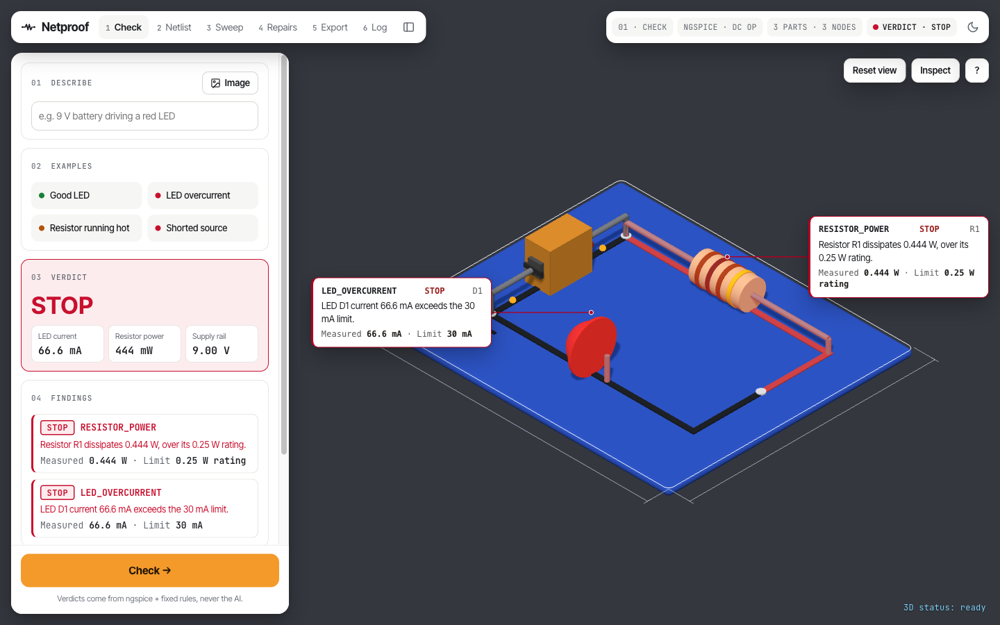

# bench.

**Design a circuit, a fiber link, or a free-space optics bench. An AI team proposes it, real physics verdicts it, and you download a build pack to build it.**

_(formerly Netproof; the Python package keeps the `netproof` name.)_

**Live:** <https://netproof-quyv.onrender.com> (Render free plan, auto-deploys on push to `main`; first load after idle takes ~50 s because free instances sleep.)

**No sign-up needed, once #3 merges:** a **"Try it as guest"** button on `/login` will create a throwaway account (random email, no password) so judges can try the app without signing up. Guest login is not in the app yet; until #3 lands, use email + password sign-up on `/login`.

## Try it in 60 seconds

1. Open the live link above and pick the **optics bench** mode.
2. Describe this setup: **"532 nm 4 mW laser, two steering mirrors, 50:50 beamsplitter, two detectors"**.
3. Watch the stats dock: the AI team proposes designs in parallel, the Judge scores them, and the best one wins. Expect **PASS**: the 50:50 split sends ~2 mW to each detector, inside the default 10 mW detector maximum, and the beams reach both detectors.
4. Now try the overload case: **"20 mW laser aimed directly at a detector"**. Expect **STOP `DETECTOR_OVERLOAD`**: 20 mW is over the detector's 10 mW maximum. The tuner autofix adds an ND filter to bring it back inside range.
5. Download the build pack PDF: parts, prices, where to buy, and assembly steps.

## Screenshot



Circuit mode: a 9 V LED circuit with a 100 Ω series resistor STOPs, with `LED_OVERCURRENT` (66.6 mA over the 30 mA limit) and `RESISTOR_POWER` (0.444 W over the 0.25 W rating).

> Stats dock screenshot: `docs/screenshots/stats-dock.png` is a placeholder path. No screenshot of the stats dock exists in the repo yet, so no image is linked here. Capture one of the live agent lanes during an optics run, save it to that path, and replace this note with the image.

## Demo video

> Demo video link goes here. The owner records it: optics prompt, team lanes, Judge, photons, tuner, PDF, about 60 seconds.

## Architecture

- **AI team proposes.** For fiber and optics, three analysts (Parts, Path, Values) read the input in parallel, then up to four designers (Faithful, Simple, Safe, Performance) propose candidates in parallel (`backend/netproof/design_ai.py`). Circuit mode runs parallel readers with majority consensus (`backend/netproof/pipeline.py`). The model only ever proposes.
- **Physics decides the verdict.** Circuits run a real ngspice DC operating-point simulation checked against fixed rules (`backend/netproof/rules.py`); fiber links get an optical power budget (`backend/netproof/fiber.py`); optics benches get a 2D ray trace (`backend/netproof/optics.py`). Verdicts are PASS, WARN, or STOP, computed by deterministic code, never by the model.
- **Judge scores and picks the best.** Every candidate is verified against the physics engine and scored 0-100; the highest score wins (`design_ai.py`, `tuner.py`).
- **Deterministic tuner improves the winner.** A coordinate search keeps a step only if the score strictly improves; autofix ends stray beams on beam dumps and adds ND filters for overloaded detectors (`backend/netproof/tuner.py`).
- **Build pack to build it.** A PDF with parts, estimated prices, buy links, hole positions, and assembly and test steps (`backend/netproof/buildpack.py`). Build packs are only issued for designs that pass; a STOP design must be fixed first.

---
Netproof is a circuit-checking tool for hobby electronics. You describe a
circuit (or paste a netlist), and Netproof tells you whether it is safe to
build — before you wire anything up.

The core principle: **the LLM proposes, the simulator decides.** A language
model may suggest a circuit, explain a problem, or propose a repair, but
every verdict comes from an actual SPICE simulation (ngspice), checked
against a fixed set of rules. The model never gets the final say on whether
a circuit passes.

## How it works

1. You submit a circuit (netlist / component list) through the API or web UI.
2. Netproof builds a SPICE netlist and, unless the pre-simulation checks
   already contain a STOP finding, runs a DC operating-point simulation
   with ngspice. When a pre-sim STOP exists, simulation is skipped and
   the report is built from the static-check findings alone
   (`_verify_netlist` in `backend/netproof/server.py`, `analyze` in
   `backend/netproof/pipeline.py`).
3. The simulation results are checked against the rule list below.
4. You get a verdict — **PASS**, **WARN**, or **STOP** — plus the specific
   rule(s) that fired and, on a STOP, a proposed repair. A repair is
   re-simulated and re-checked, but a repair is not "accepted" just
   because verification ran: `/repair` is a single repair round and
   returns `verified=true` whenever verification runs, even if the
   repaired circuit still verdicts STOP (`verified=false` only when
   verification itself errors). The pipeline's `repair_loop` runs up
   to 3 rounds and returns the best report it got, even if that report
   is still STOP. Only a PASS verdict means the repaired circuit
   re-simulated clean. The verdict is derived from the findings: any
   STOP finding means STOP, otherwise any WARN finding means WARN,
   otherwise PASS.

## Rules

Every verdict is produced by one or more of these rules, evaluated on
the netlist and, where noted below, on simulation output:

| Rule | Severity | Trigger |
| --- | --- | --- |
| `NO_GROUND` | STOP | No ground (reference node) in the circuit |
| `FLOATING_NODE` | STOP | A node is not connected to anything that defines its voltage |
| `SHORTED_SOURCE` | STOP | A voltage source is shorted out |
| `SHORTED_COMPONENT` | WARN | A component is bypassed by a short |
| `NO_SOURCE` | INFO | No power source in the circuit |
| `LED_OVERCURRENT` | STOP over 30 mA, WARN at 20-30 mA | LED current exceeds its safe limit |
| `LED_UNDERCURRENT` | INFO | LED current below 1 mA, too low for the LED to light usefully |
| `REVERSED_LED` | INFO | An LED is wired backwards (reverse-biased) |
| `RESISTOR_POWER` | STOP over 100% of rating, WARN over 70% | A resistor dissipates more power than its rating (default rating 0.25 W) |
| `SOURCE_OVERCURRENT` | WARN | A source is asked to supply more than 1 A |

Severities and thresholds are the ones in `backend/netproof/rules.py`.
`LED_OVERCURRENT`, `LED_UNDERCURRENT`, `REVERSED_LED`,
`RESISTOR_POWER`, and `SOURCE_OVERCURRENT` need a simulation result;
the rest are static checks that run even without one.

## Run it

Prerequisites: [Homebrew](https://brew.sh) (macOS) or your distro's package
manager (Debian/Ubuntu: `apt install ngspice`), [uv](https://docs.astral.sh/uv/),
and a Gemini API key for LLM features only (explanations, design, and
repair proposals; Gemini is the default provider, Anthropic works too
with `LLM_PROVIDER=anthropic`). The key is not needed to start the server or to run
simulation-only checks: the server's startup check looks only for
`ngspice` on PATH, and the LLM SDKs are imported lazily inside
`backend/netproof/llm.py`, so `/check` works with no key set.

Run from `backend/` (where the `netproof` package lives), or from the repo
root with `PYTHONPATH=backend`. Running `uv run uvicorn
netproof.server:app` from the repo root may work only after `uv sync`
has installed the package (see `pyproject.toml`: hatchling
force-includes `backend/netproof` as `netproof`); the supported form is
the `backend/` one, as in `backend/netproof/server.py` and
`scripts/demo.sh`.

```bash
# 1. Install the simulator
brew install ngspice

# 2. Install dependencies (from the repo root, where pyproject.toml lives)
uv sync

# 3. Check the install
which ngspice
uv run pytest

# 4. Set your API key (only needed for LLM features, not to start
#    the server or to run /check). Gemini is the default provider;
#    use ANTHROPIC_API_KEY with LLM_PROVIDER=anthropic instead.
export GEMINI_API_KEY=...

# 5. Start the server (from backend/, so the netproof package is
#    importable; it serves the API and the web UI on the same origin)
cd backend
uv run uvicorn netproof.server:app --reload
```

From the repo root instead: `PYTHONPATH=backend uv run uvicorn
netproof.server:app --reload` (this is what `scripts/demo.sh` does).

The server refuses to start without `ngspice` on PATH (its startup
check raises `RuntimeError` with install instructions), unless a fake
simulator has been injected via `server.set_simulator` (tests only).
`uv run pytest` runs the full suite: the server tests use that fake
simulator, so they run without ngspice; the one real-ngspice test
(`test_pipeline.py::test_real_ngspice_good_netlist_passes`) skips when
the binary is absent.

Environment variables:

| Variable | Required | Purpose |
| --- | --- | --- |
| `GEMINI_API_KEY` | No, to start the server or run `/check`; yes for LLM features (default provider) | Gemini API key, used for circuit explanations and repair proposals. The simulator, not the model, decides the verdict. The `/check` verdict path makes no LLM call, so simulation-only checks do not need the key. Set only one Gemini key: `google-genai` 3.3.0 prefers `GOOGLE_API_KEY` over `GEMINI_API_KEY` when both are set. |
| `ANTHROPIC_API_KEY` | No, to start the server or run `/check`; yes for LLM features when `LLM_PROVIDER=anthropic` | Anthropic API key (fallback provider), used for circuit explanations and repair proposals. The simulator, not the model, decides the verdict. The `/check` verdict path makes no LLM call, so simulation-only checks do not need the key. |
| `LLM_PROVIDER` | No (default `gemini`) | `gemini` or `anthropic` (case-insensitive). With `gemini`, the Gemini SDK reads the key from the environment itself (`GEMINI_API_KEY`, or `GOOGLE_API_KEY` as fallback; if both are set the SDK prefers `GOOGLE_API_KEY`, so set only one key) and uses model `gemini-4-argon` (override with `GEMINI_MODEL`); `google-genai` is an optional dependency (`uv sync --extra gemini`). `llm.py` never reads the key value. |

## Demo script

The canonical demo is a 9 V LED circuit with an undersized series resistor
(see the test fixtures `backend/tests/fixtures/led_overcurrent.json` and
`backend/tests/fixtures/good_led.json`):

1. **Submit the bad circuit.** A 9 V source, a red LED, and a 100 Ω
   series resistor. The tuned diode model (Vf ≈ 2.34 V at this
   current) lets about (9 − 2.34) V / 100 Ω ≈ 67 mA flow, over the
   30 mA STOP line, with R1 dissipating about 0.44 W, over its
   0.25 W rating.
2. **STOP.** Netproof simulates it and reports two STOP findings:
   `LED_OVERCURRENT` — the LED would burn out — and `RESISTOR_POWER`
   (R1 dissipates about 0.44 W, over its 0.25 W rating). The verdict
   comes from the simulation, not from the model's opinion.
3. **Repair.** Netproof asks the LLM for a correctly sized series
   resistor. It may propose 470 Ω or a similar value; 470 Ω is not a
   guaranteed repair outcome, it is the value in the `good_led.json`
   fixture (`backend/tests/fixtures/good_led.json`), which lets about
   (9 − 2) V / 470 Ω ≈ 15 mA flow (14.9 mA simulated, Vf ≈ 2.00 V at
   that current).
4. **Re-simulate.** The repaired circuit is simulated again.
5. **PASS.** If the proposed repair re-simulates clean, no rules fire
   and the circuit is safe to build. A repair is not guaranteed: if
   the proposed repair still STOPs, the verdict stays STOP (see
   "How it works" above).

## Project layout

```
netproof/
├── README.md            # This file
├── pyproject.toml       # uv project root: dependencies, pytest config
├── docs/
│   └── demo-image.md    # How to make the real demo schematic image
├── scripts/
│   └── demo.sh          # Demo walkthrough: starts the server
├── backend/
│   ├── netproof/        # Python package: ir, spice (ngspice), rules,
│   │                    # parts, bom, llm, pipeline, server, plus
│   │                    # __init__.py (re-exports Netlist, Component,
│   │                    # Finding, Report)
│   └── tests/           # conftest.py, test_server.py, test_pipeline.py,
│                        # test_spice.py, test_rules.py, test_llm.py,
│                        # test_consensus.py, test_bom.py, test_3d.py,
│                        # fixtures/
└── web/
    ├── index.html       # Web UI: input, verdict banner, netlist table,
    │                    # 3D view container + guarded dynamic import
    │                    # of ./3d/main3d.js
    └── 3d/
        ├── main3d.js    # 3D entry point (init3D)
        ├── scene.js     # Three.js scene, camera, picking
        ├── components.js # Component meshes + layout
        ├── interaction.js # Orbit / pick / drag / double-click
        ├── overlay.js   # Live-number overlays on meshes
        ├── edit-panel.js # Edit panel for the picked component
        ├── history.js   # Repair-history timeline (UMD)
        └── README-3D.md # 3D layer spec
```

## 3D view

`web/3d/` is a frontend-only 3D view of the circuit. It runs entirely in
the browser and never talks to the backend, the simulator, or the LLM
directly.

- **Library:** Three.js 0.160.0 via CDN
  (`https://unpkg.com/three@0.160.0/build/three.module.js`, plus
  `OrbitControls` from the same version). No build step.
- **Navigate:** left-drag on empty space orbits, right-drag pans, scroll wheel zooms
  (`OrbitControls`, damping on). Touch: one finger rotates, two fingers
  zoom/pan. Left-drag on a component moves that component instead of
  orbiting (see Drag below).
- **Click:** clicking a component selects it (raycast pick; a pointer
  release only counts as a click if it moved 6 px or less
  (`CLICK_THRESHOLD_PX = 6` in `web/3d/interaction.js`), so an orbit
  drag never selects by accident). Clicking empty space clears the
  selection. The host page receives the pick through the
  `setupInteraction` `onSelect` callback. That is the live path:
  `main3d.js` calls `createScene(element)` with no `onPick`, so
  `scene.js`'s `onPick` callback is never wired (its own pointer-up
  handler still runs a 5 px `pickAt` that only scales the picked mesh
  in place; it does not notify the page).
- **Drag:** dragging a component moves that component's mesh on the
  ground plane (`interaction.js` moves the mesh on y = 0 and shifts
  its node anchors / wire hooks with it); it never changes the
  netlist, the simulation, or the verdict. Only empty-space drag
  orbits the camera (`interaction.js` returns early when the press
  hit no component, so `OrbitControls` handles it). A drag reports
  positions through `onMove`, which is layout-only: `main3d.js`
  forwards it to the page and deliberately does not call
  `onNetlistChange`, and the page's `onMove` hook is a no-op.
- **Edit:** double-click is the edit gesture: `interaction.js` fires
  `onEdit` on double-click and `main3d.js` opens the edit panel
  (`web/3d/edit-panel.js`), where its value, power rating, and (for LEDs)
  colour can be changed. All three panel buttons re-simulate through
  the page: Save applies the edit and POSTs `/check`, Re-check does
  the same, and Repair applies the edit and POSTs `/repair`. The page
  supplies all three hooks (`onEdit`, `onRecheck`, `onRepair`) to
  `init3D`; without them the panel disables the Re-check / Repair
  buttons. Signature trap, pinned by
  `backend/tests/test_3d.py::test_index_edit_panel_hooks_match_main3d_signatures`:
  `onEdit` gets `(id, updatedRow, netlist)` but `onRecheck` /
  `onRepair` get `(updatedRow, netlist)` — the row carries its own
  id. Passing `(id, updated)` for those two silently no-ops
  (`applyEdit` finds no row for an object id). The panel's
  measurements and the 3D labels look Report values up
  case-insensitively (`lookupCI` in `edit-panel.js` / `overlay.js`):
  ngspice lowercases branch-current keys (`"r1"`) while power keeps
  the component id (`"R1"`), so an exact lookup showed "—" for
  current in the panel and power with no current on the labels.
- **Numbers come from ngspice only.** The 3D view holds no simulation
  numbers of its own. Mesh colours come only from the verdict values
  passed in by the host page, which must come from a real `/check` run
  (PASS green, WARN amber, STOP red). Voltages, currents, and power shown
  in the edit panel come only from that `/check` report; a value missing
  from the report is shown as "—", never guessed or filled in.

Status: wired into `web/index.html` — the page carries an import map
mapping `three` to the same 0.160.0 URL, a `#scene3d` container, and a
guarded dynamic import of `./3d/main3d.js` (in `try/catch`: if the import
or init fails, the flat page keeps working and the 3D container shows
the failure instead of an error). All seven `web/3d/*.js` modules exist
(`main3d.js`, `scene.js`, `components.js`, `interaction.js`,
`overlay.js`, `edit-panel.js`, `history.js`). The server serves the
whole `web/` directory same-origin (static mount after the API routes),
so the `./3d/main3d.js` import resolves instead of 404ing. Test
coverage is thin and uneven: only `main3d.js` has an HTTP serving test
(`test_server.py::test_3d_main_script_served_as_javascript` GETs
`/3d/main3d.js` and checks for a 200, a JavaScript content type, and
`init3D` in the body). The other six modules are covered only by
`backend/tests/test_3d.py`, which checks on disk that each file exists,
is non-empty, and contains its key function name as a string — no JS
is executed and no module is imported. Live in-browser rendering is
not covered by the backend test suite; the tests cover serving the
files, not running them.

## Known limits

- **Server needs ngspice to start.** `backend/netproof/server.py` exists
  and serves the API plus the web UI, but its startup check refuses to
  start without the `ngspice` binary on PATH (tests inject a fake
  simulator instead, so they run without it).
- **3D view is wired in and browser-verified in P4 (fake simulator).**
  `web/index.html` loads `./3d/main3d.js` and the server serves it; P4
  ran the page in headless Chromium against an analytic fake simulator
  (no ngspice in that VM): the 3D canvas renders, colours follow the
  verdict, click-select works both ways (3D → table row, table row →
  3D), the edit panel's Save / Re-check / Repair all re-simulate, and
  labels show voltage, current and power from the Report. What P4 did
  NOT prove: the same against real ngspice, against the real unpkg
  CDN (Chromium in that VM cannot reach it; three.js was served
  locally via route interception), or with a real LLM key. Those need
  a Mac with network.
- **Real Repair to PASS needs a Mac with a working LLM key.** The
  default provider is Gemini (`LLM_PROVIDER=gemini`,
  model `gemini-4-argon`, key `GEMINI_API_KEY` or `GOOGLE_API_KEY`;
  Anthropic is the fallback with `LLM_PROVIDER=anthropic`). As of
  2026-11-15 the Gemini keys on hand both return `API_KEY_INVALID`
  and the account that issued them looks shut down, so LLM paths
  (`/run-image`, `/run-goal`, Repair) fail loudly until a new Gemini
  key is sorted, or `LLM_PROVIDER=anthropic` with a working Anthropic
  key is used. `/check`, both downloads, and the 3D view need no key.
  P4 verified the full STOP → Repair → PASS loop end to end in the
  browser with a deterministic repair stub standing in for the LLM
  (100 Ω → 470 Ω) and the analytic fake simulator; the LLM's own
  repair judgement is the unproven part, not the endpoint or the
  re-simulation.
- **CDN dependencies fall back, they do not fail the page.** Three.js
  comes from unpkg and the IBM Plex fonts from Google Fonts. On a
  network that cannot reach them the 3D view shows its fallback text
  and the page uses system fonts; the flat page, `/check`, and the
  downloads keep working.
- **Example picker covers 4 of the 11 fixtures** (good LED, LED
  overcurrent, resistor warn, shorted source). The other 7 fixtures
  exist only as `backend/tests/fixtures/*.json` and are exercised
  through `/check` directly, not through the picker.
- **DC operating point only.** Netproof runs a DC operating-point
  simulation. It does not do transient analysis or AC analysis, so it
  cannot check anything that depends on time, switching, or frequency
  (capacitor charging, oscillation, filters, PWM, and similar).
- **Simulation is only as good as the model.** Results depend on the
  component values and models supplied. Wrong values in, wrong verdict out.
- **No accuracy claims.** Netproof makes no claims about how often its
  verdicts match a bench measurement, and no benchmark numbers are stated
  anywhere in this project. The guarantee is narrower and checkable: every
  verdict is derived from a real simulation run against the rule list
  above, never from the language model alone.

## Credits

3D part models (resistor, LED, capacitor, diode) are from the [KiCad 3D library](https://gitlab.com/kicad/libraries/kicad-packages3D), CC-BY-SA 4.0. See `web/3d/models/kicad/README.md`.
